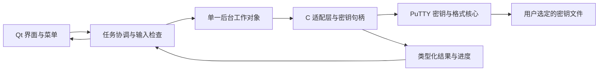

# PuTTYgen 跨平台 GUI 技术设计

## 状态与设计基线

本方案已获用户最终批准，任务已进入 `in_progress`。所有用户产品决策已记录在 `prd.md`。首版作为一个完整工具交付，核心、GUI 和发布步骤按同一验收清单串行推进，暂不建立没有独立用户交付价值的父子任务树。

- 密钥处理与行为基线：官方 PuTTY 0.85，归档 SHA256 为 `13fd4db2936d03b73812a7bcc2a658e4dd29cc776a56c3670a7fc6f1a0ee8af8`。
- GUI：Qt 6 Widgets，C++17；密码适配层与上游保持 C99，避免将不兼容的上游 C 头直接包含进 C++。
- Windows／Ubuntu 发布兼容性构建：Qt 6.8.3 公开源码作为可复现的初始基线；仅依赖 6.8 已有 API。发行前检查适用补丁并固定最终版本和校验，不随本机 Qt 自动变更发布依赖。Arch 原生包使用该发行版系统 Qt 6.8 以上，按滚动仓库的运行依赖管理。
- 本机检测到 Qt Core/Widgets/Test 6.12.0 和 CMake 4.4.4，可供后续开发冒烟；它们不是 6.8 发布兼容验证的替代。
- Windows 使用 MSVC 2022 x64，Linux 分别在 Ubuntu 22.04/GCC 11 和 Ubuntu 24.04/GCC 13 环境构建；CMake 3.24 以上，Ninja。

## 模块边界与拟定目录

| 路径 | 责任 |
| --- | --- |
| `CMakeLists.txt` | PuTTY 套件顶层入口，通过 `PUTTY_BUILD_PUTTYGEN` 选择本期组件。 |
| `apps/puttygen/CMakeLists.txt` | PuTTYgen 独立组件，管理核心、GUI、测试及发布目标。 |
| `apps/puttygen/src/core/` | 面向密钥工具的 C 适配、不透明句柄、参数、错误、进度、随机和文件处理。 |
| `apps/puttygen/src/app/`、`apps/puttygen/src/ui/` | Qt 单工作线程、公开会话、语言偏好、主窗及各对话框。 |
| `apps/puttygen/resources/` | 嵌入式 JSON 翻译、图标、离线帮助与许可引用。 |
| `apps/puttygen/tests/` | 组件核心互操作和 GUI 交互；构建哈希隔离的测试产物仍位于仓库 `.tmp/`。 |
| `apps/puttygen/cmake/`、`apps/puttygen/packaging/` | 该组件的 Windows ZIP、Ubuntu DEB、Arch PKGBUILD 和安装验证。 |
| `vendor/putty/`、`vendor/patches/` | 套件共享的固定上游源码、原许可证和可追溯最小补丁。 |
| `cmake/UpstreamPuTTY.cmake` | 公共上游密码与密钥静态目标接入。 |
| `tools/qt/`、`tools/ubuntu-build-dependencies.sh` | Qt 来源锁、构建与许可收集，以及共享构建环境依赖。 |
| `.github/workflows/puttygen.yml` | 本期组件 Windows、两 Ubuntu 与 Arch 的构建、测试和发布包检查。 |
| `docs/`、`README.md` | 套件结构与公共构建指南；组件自身使用说明放组件 README。 |
| `.tmp/` | 仓库唯一开发临时根，下载、构建、测试和打包暂存均置于此处。 |

用户已明确仓库名为 `putty`，PuTTYgen 是其中的组件。上述目录作为最终责任边界：组件适配层目前服务 PuTTYgen，不提前泛化为其他工具 API；只有确实共享的上游与 Qt 工具放公共目录。目录迁移只改变构建路径，既有行为与接口保持，并重新运行全工程测试和打包检查。现有 `.trellis/spec/` 是模板；实施中有真实代码后再更新具体规范，不把 Web/数据库模板当作桌面项目约束。

## 数据流与契约

### 密钥与参数

- C 适配层拥有密钥及其内存；C++ 只传递不透明句柄和请求，不能自行解释 `RSAKey`、`ssh2_userkey` 等结构。
- 生成参数包含算法、位数或曲线、素数策略、强素数开关；保存参数包含格式、PPK 版本及 KDF 选项，均定义为自有枚举或结构。
- UI 显示公开信息快照：算法、位数/曲线、指纹、公钥文本、注释、证书信息及各格式能力。私钥不放入公开状态快照。
- C 返回值和分配内存由同一适配层提供释放函数，不能跨 C/C++ 分配器混用；使用 RAII 管理调用边界。
- 基础类型和用户输入由协调层检查，密码参数与格式适用性继续使用上游校验；菜单禁用只是展示，后端仍应拒绝无效操作。
- 错误区分口令错误、文件无效、不支持格式、参数错误、文件读写失败、证书不匹配和系统随机源失败；取消不是错误或成功。已知错误提供可翻译提示，原始上游细节作为诊断信息。

### 文件与密钥替换

- 文件类型按内容识别；支持原版 Load 与 Import 在提示行为上的区别。
- 加载成功后替换当前密钥，失败或取消不提交半成品。保存时先核对口令、格式和参数，再选择路径并执行原版覆盖确认。
- 尽量使用上游内存解析接口；需要文件接口的导出功能使用用户明确选定的目标路径，不通过临时私钥文件串接 CLI。
- 采用平台 Unicode 文件接口适配，确保含中文与空格路径正确。保存沿用原版写入语义；写入失败必须明确反馈，不能宣称写入一定具有原子替换保证。
- 系统配置只保存本程序语言偏好，使用独立应用标识，不改写原版 PuTTY 会话注册表或目录。

## 线程、状态与敏感数据

- Qt GUI 线程只处理控件和公开状态；一个后台工作对象串行负责生成、解析、KDF、导出及密钥销毁，通过排队信号返回结果。
- 上游随机模块含全局状态。原版 `windows/puttygen.c:2609` 使用 `random_setup_special()`，`putty.h:2245` 映射到自定义随机初始化；`sshrand.c:94`、`:102`、`:126` 提供引用与清理逻辑。所有随机状态和密钥操作归同一线程，不从 UI 与后台并发调用。
- 完成最低依赖验证时明确上游噪声、计时与随机种子回调的行为；平台随机适配必须读取 Windows/Ubuntu 的系统安全随机源，失败时阻止生成。鼠标熵流程保留原版采集与限速语义，再混入上游 PRNG，不自创密码算法。
- 主状态为无密钥、收集熵、后台处理中、已有密钥；操作类型和上一个可恢复状态另行记录。证书、算法、当前格式能力由统一状态投影决定主窗和菜单可用性。
- 任务过程中禁用冲突操作；退出请求不能直接强杀工作线程。若上游调用无法安全中止，等待后台任务结束后释放对象并关闭，等待过程保持 GUI 响应。
- 操作结束清理一次性口令和敏感缓冲区；控件为维持原版编辑流程所持有的口令在换密钥/退出时清空。避免额外隐式共享副本，不宣称 Qt 字符串所有历史副本均可被可靠擦除。
- 日志、命令行、翻译上下文和截图测试报告不得包含真实私钥或口令；测试只使用专门生成的测试夹具。

## GUI 对照与本地化

- 所有 G01–G15 由主窗 QAction 与共享命令处理器连接，按钮和菜单不实现两套业务逻辑。
- 保留参数区随算法切换、证书区替代公钥区、加载后的口令与注释、格式不适用时禁用导出等原版行为。
- 原版资源 `windows/puttygen.rc:22`、`:35`、`:47`、`:57`、`:86` 对应口令、关于、许可证、PPK 参数和证书对话框；关于中保留许可证查看和官网操作。
- 增加用于语言切换的菜单入口；通过 QTranslator 和翻译资源提供中文/英文，首次启动加载中文，偏好只保存语言代码。切换只更新文本，不重建密钥对象或清空输入。
- 统一 UTF-8 源码；保留原版算法、格式与参数术语。英文用于原版对照，中文验证字体、助记键、文本长度与数值单位。
- 原版 Windows 帮助替换为内置离线帮助；许可原文完整展示。控件的背景说明只解释使用方法，不能展示 PRD、实施步骤或验证状态。

## 构建、发布与兼容策略

- 工程分别编译 C 与 C++，只链接密钥生成、格式读写、密码、必要工具及平台适配；不构建或打包终端、网络客户端、GTK 程序。
- 上游源码和 Qt 依赖版本/校验应记录，补丁单独可追溯。Qt 动态链接，发布相应许可、第三方通知和源码获取信息；验证实际模块的许可材料。
- Windows ZIP 包含程序、匹配版本 Qt DLL、平台插件、必要运行库与帮助资源，双击可运行。
- Ubuntu 22.04 与 24.04 分别构建 DEB 包；Qt 库和插件使用经过该发行版验证的版本或构建，声明实际系统依赖。安装后从桌面入口启动，卸载只移除本程序。
- Arch x86_64 在独立 Arch 环境中由普通用户执行 `makepkg`，使用当前检出源码生成 `.pkg.tar.zst` 与 SHA256；程序安装到 `/usr/bin`，桌面入口、图标和许可按系统目录安装，由 pacman 管理 Qt 运行依赖。该分支不部署私有 Qt、`/opt` 包装器或指向私有库的 RPATH，不复用 Ubuntu 二进制。
- Arch Actions 执行核心与 GUI 自动测试，并在隔离环境验证 pacman 安装、offscreen／XCB／Wayland 启动及卸载；报告通过宿主收集器上传到独立报告目录。包、校验和与环境版本记录一并提供，滚动环境结果不能被表述为固定发行版永久兼容承诺。
- Linux 的 X11/Wayland、文件对话框、剪贴板、鼠标移动和高 DPI 均纳入实际桌面验收；无显示环境的测试不代替真实桌面验收。
- 所有构建目录、缓存、测试运行根与打包暂存显式放到项目 `.tmp/`，并通过测试环境变量/测试夹具覆盖默认临时目录。

## 验证策略

完整映射见 `implement.md`。核心验证以公钥和指纹一致、适用格式往返、上游 CLI 可读取及受控签名验证为依据。随机字节、加密盐和生成时长无需逐字节对齐。证书使用已匹配、不匹配及无效输入夹具，旧算法使用其适用版本和格式验证，不能用现代 OpenSSH 拒绝某旧格式来否定原版功能。

Qt 测试重点覆盖菜单/按钮同义、状态转换、口令/参数/覆盖确认与双语切换。Windows 与 Ubuntu 的发布验收记录必须区分编译、自动测试、原生 GUI 实测和发布包安装结果。

## 风险与实施阶段验证项

| 项目 | 处置与通过条件 |
| --- | --- |
| C 核心的最小链接集合、随机与计时回调 | 第一阶段做两平台链接和核心生成验证，禁止假设上游是现成稳定库；结果写入研究记录。 |
| Qt 公开补丁版与 Ubuntu 系统库基线 | 兼容构建固定版本，分别验证两个 Ubuntu 发布包；本机 6.12 测试不能代替目标 6.8 验证。 |
| 原生 Windows 运行环境 | 配置 Windows 构建/测试流程，并准备 Windows 10/11 原生运行验收；没有证据时保持该项未完成。 |
| 长时生成无法立即取消 | 不强杀线程，保证退出等待可见且界面响应；不新增虚假的即时取消承诺。 |
| 原版 GUI 的细分边界 | 实施时逐项核对完整源文件、资源和原生程序；发现遗漏只补齐，不降级已确认范围。 |

这些是执行顺序中的技术验证，不是未决定的产品范围。若发现无法满足系统或功能要求，返回规划说明差异，不能静默缩减范围。

## 回退与维护

上游目录与适配层分离，更新依赖可独立回退；保留原版 CLI 作测试对照工具，不作为用户运行依赖。版本升级必须重新运行 G01–G15 和格式互操作验证。各阶段可形成审阅点，但最终完成条件必须包含全部平台与完整功能。
